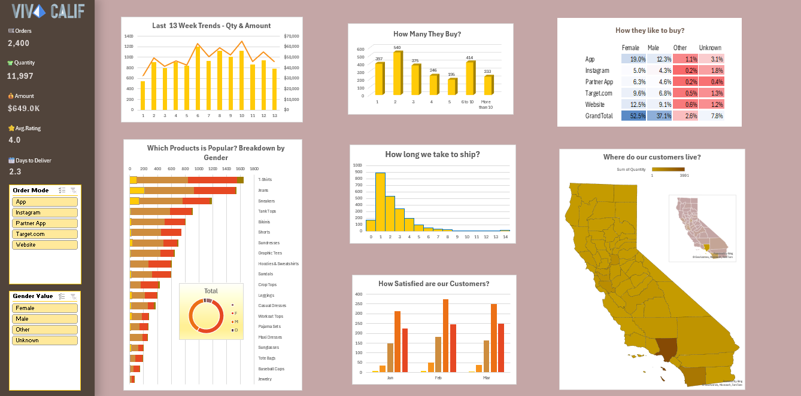

# Fashion Retail Sales Analytics Dashboard | Microsoft Excel

## 1. Project Overview

The **Fashion Retail Sales Analytics Dashboard** is an interactive Excel-based data analysis project developed to explore fashion retail sales performance and identify meaningful business insights.

Using a fictional dataset of 2,400 transactions from January to March 2025, the project analyzes sales trends, product performance, customer purchasing patterns, and delivery operations.

The raw transaction data is transformed into an interactive dashboard using Microsoft Excel features such as PivotTables, PivotCharts, KPI cards, slicers, conditional formatting, and map charts.

**Project Goal:** To convert raw retail sales data into meaningful insights through data analysis and interactive visualization.

## 2. Business Problem

Retail businesses need to monitor sales performance, understand customer purchasing behavior, and evaluate operational efficiency.

This project addresses the following business questions:

- How does revenue change over time?
- Which products contribute most to overall sales?
- How do purchasing patterns differ across gender segments?
- What insights can be identified from delivery performance?
- How can interactive dashboards support better business reporting?

## 3. Dataset Information

| Attribute | Description |
|---|---|
| Industry | Fashion Retail |
| Total Transactions | 2,400 |
| Time Period | January – March 2025 |
| Data Type | Fictional Retail Transaction Data |
| File Format | Excel |
| Data Source | Fictional dataset |

The dataset contains transaction-level information used to analyze sales, products, customer segments, and delivery performance.

## 4. Tools & Technologies

| Tool / Feature | Purpose |
|---|---|
| Microsoft Excel | Data analysis and dashboard development |
| PivotTables | Data summarization and aggregation |
| PivotCharts | Visualizing sales performance |
| Excel Formulas | KPI calculations |
| Slicers | Interactive data filtering |
| Conditional Formatting | Heatmap analysis |
| Map Charts | Geographic sales visualization |

## 5. Key Performance Indicators (KPIs)

The dashboard tracks five key performance indicators:

- **Total Orders:** Overall number of orders.
- **Total Quantity Sold:** Total units purchased.
- **Total Revenue:** Revenue generated from transactions.
- **Average Customer Rating:** Average customer rating.
- **Average Delivery Days:** Average delivery duration.

## 6. Analysis & Visualizations

The project includes the following analytical views:

**1. Sales Trend Analysis**
- Examines monthly revenue performance.
- Identifies changes in sales over time.

**2. Product Performance Analysis**
- Compares product and category-level sales.
- Identifies products contributing to overall revenue.

**3. Gender-Based Sales Analysis**
- Analyzes purchasing patterns across gender segments.
- Compares sales contributions.

**4. Delivery Performance Analysis**
- Examines average delivery duration.
- Provides an overview of delivery-related patterns.

**5. Heatmap Analysis**
- Uses conditional formatting to highlight data patterns and variations.

**6. Geographic Sales Analysis**
- Uses Excel Map Charts to visualize geographic sales distribution.

**7. Interactive Dashboard**
- Combines KPIs and visualizations in a centralized dashboard.
- Uses slicers to filter supported reports and explore different data views.

*Note: The geographic map chart does not respond to all dashboard slicers.*

## 7. Dashboard Preview

The following screenshot provides an overview of the interactive Excel dashboard.



## 8. Key Business Questions Explored

- What is the overall revenue generated during the analysis period?
- Which products or categories contribute most to sales?
- How does sales performance vary across months?
- Are there differences in purchasing patterns across gender segments?
- What patterns can be observed in delivery performance?
- How can interactive filtering improve sales analysis?

## 9. Business Value

This project demonstrates how Microsoft Excel can be used to transform raw retail transaction data into an interactive business reporting solution.

The dashboard can support:
- Sales performance monitoring.
- Product and category performance evaluation.
- Customer purchasing pattern analysis.
- Delivery performance monitoring.
- Data-driven business discussions.

## 10. Project Structure

```text
Fashion-Retail-Sales-Analytics/
│
├── Fashion_Retail_Dashboard.xlsx
│
├── dashboard.png
│
└── README.md
```

## 11. How to Explore the Project

1. Clone or download this repository.
2. Open `Fashion_Retail_Dashboard.xlsx` using Microsoft Excel.
3. Navigate to the dashboard worksheet.
4. Review the KPI cards and visualizations.
5. Use the available slicers to interact with supported dashboard reports.

## 12. Skills Demonstrated

- Microsoft Excel
- Data Analysis
- Exploratory Data Analysis (EDA)
- Data Summarization
- PivotTables and PivotCharts
- Excel Formulas
- KPI Development
- Conditional Formatting
- Data Visualization
- Interactive Dashboard Development
- Business Reporting


